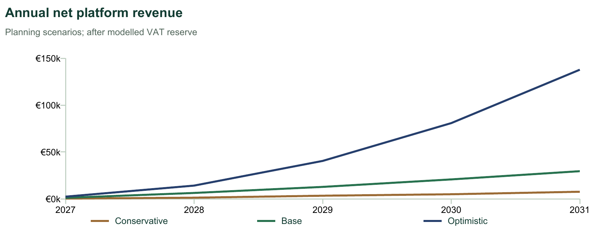

# Restringing.ie

## Business proposal

An Irish marketplace for racket servicing, with a staged route into professional stringing software.

17 November 2026

Prepared for potential commercial partners, clubs, investors and enterprise advisers.

Planning status: pre-launch. Revenue, customer demand and commercial partnerships remain unvalidated.

<!-- pagebreak -->

## Contents

| Section | Page |
| --- | --- |
| 1. Executive summary | 3 |
| 2. Company overview | 4 |
| 3. Problem and market opportunity | 5 |
| 4. Proposed solution | 6 |
| 5. Current product and technology | 7 |
| 6. Market analysis | 8 |
| 7. Competitive analysis | 9 |
| 8. Business and revenue model | 10 |
| 9. Marketing and customer acquisition | 11 |
| 10. Product roadmap | 12 |
| 11. Operations and partnerships | 13 |
| 12. Financial projections and funding | 14 |
| 13. Risks and mitigation | 17 |
| 14. Growth and international expansion | 18 |
| 15. Implementation milestones | 19 |
| 16. Decision and next steps | 20 |
| 17. Sources and appendices | 21 |
| Research bibliography | 24 |

The financial plan assumes a January 2027 pilot and forecasts calendar years 2027 to 2031. All projections are estimates. No sales, signed customers, available founder capital or investment commitments have been established.

The immediate commercial decision is whether a small Irish pilot can demonstrate repeat use and a reason for stringers to pay. Hardware purchases and international launch spending depend on later evidence.

<!-- pagebreak -->

## 1. Executive summary

Restringing.ie proposes to connect Irish tennis players with local racket stringers and give those businesses a shared booking and service-management system. Players would compare services, choose a string setup and follow a racket through to collection. The founder's competitive tennis background and relationships within Irish tennis provide a practical route to recruiting the first participants. Those relationships have not yet been converted into verified commercial commitments.

The software already contains a substantial marketplace workflow. The repository describes a product under development, a public coming-soon page and a separate preview application. Customer payments are cash paid to the stringer. Stripe subscription code exists for business accounts, subject to configuration and operational checks. Online customer card payments, tournament-specific software and lockers remain future work. [Product evidence](https://github.com/daviddoherty10/Restringing.ie/blob/5ec1eb10d4f60601bbb39c52a9fc17f7edb8078d/README.md)

Ireland is suitable for a focused launch. Tennis Ireland's 2024 report records 93,807 memberships across the island; that total cannot be treated as a Republic-only customer count. An illustrative Republic market of 84,000 players, buying two €30 restrings annually, gives €5.04 million in annual service spending. Both the player adjustment and purchase frequency are assumptions. This is spending received by stringers, not platform revenue. [Market source](https://www.tennisireland.ie/wp-content/uploads/2025/06/Tennis-Ireland-2024-Annual-Report-Final.pdf)

The proposed €15 monthly subscription, following a five-booking allowance, makes initial adoption affordable. It also limits revenue. In the base scenario, net platform revenue reaches €1,080 in 2027 and €29,521 in 2031, with an operating deficit of €35,270 in 2031 after the planned founder and contractor cash cost. A full-time business needs higher spending per professional account, a much wider software market, or substantially lower costs. The optimistic case reaches a small operating surplus in year five but still needs cash for locker purchases.

A controlled first-year pilot requires approximately €18,039 including startup expenditure and a €3,000 buffer. This is a planning requirement, not a fundraising commitment. The recommended first allocation is a €20,000 maximum pilot envelope, released in stages after legal readiness and customer interviews. It excludes founder salary.

Seek ten founding stringing businesses, five club access agreements and two tournament design partners. Test actual willingness to pay before extending the build. Keep lockers outside the base plan until a host, insurer and stringer agree a workable collection route.

<!-- pagebreak -->

## 2. Company overview

Restringing.ie is a founder-led software project serving the Republic of Ireland initially. Its mission is to make racket restringing easier to arrange and easier to manage. The longer-term ambition is to connect local servicing with tournament operations and reliable racket data.

The founder is a competitive Irish tennis player with a software development background. The handoff describes meaningful relationships across Irish competitive tennis. This should shorten the route to interviews and pilot introductions, although demand and acquisition costs still need measurement.

The legal operating entity, registration status, founder's legal name and available financial resources have not been confirmed. Before taking public bookings or paid subscriptions, the founder must identify the contracting operator, register the business and tax arrangements that apply, and confirm ownership of the software and brand. Registering a business name does not create a separate company. [CRO](https://cro.ie/registration/), [Revenue](https://www.revenue.ie/en/starting-a-business/starting-a-business/registering.aspx)

### Initial customer groups

| Group | Immediate need | Proposed offer |
| --- | --- | --- |
| Club and competitive players | A dependable local service and repeatable setup | Search, booking, saved service records and collection updates |
| Newer players | Help choosing an appropriate starting setup | Plain-language recommendations with stringer review |
| Independent stringers | Fewer messages and usable job records | Booking, stock, pricing and order management |
| Clubs and coaches | A reliable service for their players | A named local stringer and an agreed handover process |
| Tournament teams | A queue that staff can trust | A later tournament module, tested at small events first |

The pilot should focus on one cluster where the founder can personally support participants. Dublin and its surrounding counties are a reasonable first hypothesis because of the founder's network and the concentration of established services. Confirm that choice against actual stringer interest and travel times.

The founder initially owns product decisions, onboarding and support. Use limited external legal and accounting advice. Add paid help only when the workload and cash plan justify it. Year-one forecasts assume unpaid founder work, which makes the pilot affordable but does not establish a sustainable salary.

<!-- pagebreak -->

## 3. Problem and market opportunity

A player can already arrange a restring through a club, coach, shop or independent stringer. These relationships often work well. The proposed opportunity is to improve the parts that require repeated coordination: finding an available provider, recording a precise setup, agreeing a collection arrangement and checking progress.

For a beginner, a list of string names and tensions can be difficult to interpret. Experienced players need the opposite: enough detail to reproduce their mains, crosses, gauge and tension accurately. A useful booking flow must handle both cases without pretending that software can diagnose pain or guarantee performance.

Stringers can lose time answering the same questions and tracing previous jobs. Some use dedicated software already; others use paper, messaging or spreadsheets. Restringing.ie needs to demonstrate that the reduction in administration and the extra bookings outweigh the work of maintaining another system.

### Questions the pilot must answer

| Hypothesis | Evidence to collect | Proposed decision threshold |
| --- | --- | --- |
| Players want a shared booking route | Completed jobs and repeat orders by cohort | At least 25% of eligible pilot customers return within 90 days |
| Stringers will use the dashboard | Weekly usage and jobs recorded | Eight of ten founding businesses active after eight weeks |
| Busy stringers will pay | Paid invoices after a disclosed trial | At least five paying businesses by month six |
| Booking reduces coordination | Before/after message count and staff minutes | A measurable reduction reported by most pilot businesses |
| Supply can meet promises | Acceptance, promised date and collection time | At least 90% of accepted jobs ready by the agreed date |

These thresholds are management choices, not sector benchmarks. Low-frequency players may not need another restring within 90 days, so report repeat use separately for frequent and occasional players. A customer retained for six months is more informative than a short burst of promotional orders.

Growth in participation can enlarge the pool of potential users, but it does not prove willingness to switch provider. Sport Ireland's 2025 monitor reports about 2.12 million adult sports participants across all sports. It provides context only; the financial model does not convert that figure into tennis customers. [Sport Ireland](https://www.sportireland.ie/research/national-adult/ism-2025)

<!-- pagebreak -->

## 4. Proposed solution

The first release should support a complete local service journey. A player finds a stringer, chooses a racket and setup, reviews the final price and requests the service. The stringer accepts the job and agrees the handover. Progress updates continue until collection, with payment recorded separately.

A beginner should be able to say how often they play and what they want from the setup. Recommendations should explain the reason for a suggested option, state relevant limits and allow a stringer to review it. Advanced players should be able to choose full-bed or hybrid strings and enter tension in kilograms or pounds.

### Service boundaries

| Restringing.ie | Stringing business | Player |
| --- | --- | --- |
| Publishes profiles and supports booking | Confirms capacity, price and promised date | Supplies accurate racket and contact details |
| Stores setup and progress records | Inspects the racket and performs the work | Delivers and collects as agreed |
| Provides complaint and account workflows | Takes cash and manages service remedies | Reviews the terms and pays the stringer |
| Maintains the platform and access controls | Reports delays and damage promptly | Authorises any agreed changes |

The proposed contracting model is that the stringer supplies the restringing service and Restringing.ie supplies the platform. A solicitor must check that the terms, booking screens and actual conduct support that model. A contractual label alone does not settle responsibility.

The player should see the full price, what materials are included, the expected completion date and who handles complaints before committing. Optional extras must be chosen actively. The service should distinguish a request awaiting acceptance from a confirmed job. [CCPC service guidance](https://www.ccpc.ie/information-for-businesses/selling-goods-and-services/selling-services)

Collection should begin with direct handover or an agreed staffed club desk. This avoids buying equipment before the business knows how many handovers need out-of-hours access. The pilot should record missed handovers, travel and opening-hour constraints to establish whether lockers would solve a frequent problem.

<!-- pagebreak -->

## 5. Current product and technology

The repository's current main branch was checked at commit `5ec1eb10d4f60601bbb39c52a9fc17f7edb8078d`. Local source and feature guides were also reviewed. Uncommitted application work has not been treated as a released capability. This assessment establishes what is represented in source; it does not certify the live deployment.

| Capability | Evidence and status |
| --- | --- |
| Stringer discovery, profiles and service pricing | Present in source; production supply and profile accuracy need verification |
| Catalogue, full-bed/hybrid booking, kg/lb entry | Present; production product and racket data require curation |
| Beginner recommendations | Guided flow present; suitability needs expert-reviewed production data |
| Orders, tracking and conversations | Present; live customer journey still needs staging evidence |
| Inventory, grips and express services | Present; stock and service rules depend on business configuration |
| Business staff access and images | Present in current overview; permissions and uploads need operational checks |
| SMS sign-in and opted-in order alerts | Provider-dependent; configuration and real-device delivery need validation |
| Business subscription billing | Stripe code present; production price and billing activation unverified |
| Customer payments | Cash to stringer, with manual receipt records; online card payment is future work |
| Legal and trader controls | Workflows present; legal pages are drafts and enforcement defaults are disabled |
| Tournament queues, passport and lockers | Proposed development; ordinary orders and racket records provide reusable foundations |
| Appointment scheduling and stencilling | Availability indicators exist; a full slot calendar or dedicated stencil workflow is not established |

The stack is React/TypeScript, a Go API and PostgreSQL, with Docker/Coolify deployment configuration. The handoff identifies a Hetzner VPS. No VPS access, infrastructure bill or backup restoration was verified for this proposal.

Before launch, prioritise curated catalogue data, solicitor-reviewed customer terms, trader onboarding, provider testing and a complete booking-to-collection rehearsal. Confirm restore procedures and support coverage. Existing automated tests provide development evidence, but mocked browser responses do not establish live billing or SMS delivery.

[Repository overview](https://github.com/daviddoherty10/Restringing.ie/blob/5ec1eb10d4f60601bbb39c52a9fc17f7edb8078d/README.md), [subscription rules](https://github.com/daviddoherty10/Restringing.ie/blob/5ec1eb10d4f60601bbb39c52a9fc17f7edb8078d/docs/subscriptions-and-cash.md)

<!-- pagebreak -->

## 6. Market analysis

Tennis Ireland operates across the island. Its 2024 report records 93,807 memberships and 190 affiliated clubs; its current website describes 192 clubs and almost 100,000 players. These measures and dates differ. Neither is a verified count of unique Republic residents buying restringing services. The 2025 report is listed, but its numerical contents could not be retrieved within the research tool's file limit. [2024 report](https://www.tennisireland.ie/wp-content/uploads/2025/06/Tennis-Ireland-2024-Annual-Report-Final.pdf), [current overview](https://www.tennisireland.ie/about), [2025 report listing](https://www.tennisireland.ie/about/governance)

An older active-membership database shows a strong Leinster concentration: 42,094 in Leinster, 14,115 in Munster, 2,734 in Connacht and 5,657 in Ulster. This 2023 series is useful for broad geographic prioritisation only. Ulster spans jurisdictions, and the database is not interchangeable with affiliated membership totals. [2023 report](https://www.tennisireland.ie/wp-content/uploads/2024/08/Tennis-Ireland-2023_Annual-Report-Final.pdf)

### Addressable service spending

| Measure | Transparent planning calculation | Annual service value |
| --- | --- | --- |
| TAM, low | 67,000 Republic players × 1 restring × €25 | €1,675,000 |
| TAM, central | 84,000 Republic players × 2 restrings × €30 | €5,040,000 |
| TAM, high | 90,000 Republic players × 3 restrings × €35 | €9,450,000 |
| Initial SAM | 12,000 reachable players × 40% annual buyers × 2 × €30 | €288,000 |
| Year-one SOM target | 1,200 customers × 1.2 completed jobs × €30 | €43,200 |
| Year-three SOM target | 4,000 customers × 1.5 completed jobs × €30 | €180,000 |

All player counts in these calculations are assumptions. The central 84,000 rounds 90% of the 2024 all-island membership figure; 90% is an unverified Republic allocation. Non-members are excluded, and possible duplicate memberships are not corrected. Frequency and buyer share have no representative Irish survey behind them.

SOM measures attributed completed marketplace demand. The financial workbook counts all software-managed bookings, including a stringer's existing customers, and therefore uses a different denominator. For capacity, 1,440 completed jobs require ten businesses averaging three jobs weekly over 48 weeks. Confirm spare capacity before promising that volume.

The separate subscription opportunity is small at €15 monthly: even 200 continuously paying businesses generate €36,000 gross annually before VAT and costs. There is no verified national count of commercial stringers. Replace this illustration with a county-by-county supply register during the pilot.

<!-- pagebreak -->

## 7. Competitive analysis

Irish players already have accessible alternatives. Tennis.ie advertises restringing from €25 including string and €20 labour only. Racket Service Dublin starts at €24 including an overgrip, with €17 labour for supplied string. Big Hit in Arklow lists €25 to €30 including string and €15 labour. Galway Lawn Tennis Club publishes €18 where the player supplies string. These examples support a €30 planning basket, but they are a small advertised sample, not a national average. [Tennis.ie](https://tennis.ie/pages/racket-restringing-service), [Dublin](https://racketservicedublin.com/), [Arklow](https://www.bighittennisacademy.com/restringing), [Galway](https://gltc.ie/pro-shop/)

| Alternative | Why customers use it | Implication for Restringing.ie |
| --- | --- | --- |
| Local shop or club stringer | Established trust and convenient handover | Recruit willing operators and preserve their customer relationships |
| Coach referral or WhatsApp | Personal advice and little setup | Booking must reduce effort enough to justify switching |
| Dedicated stringing software | Existing job records and professional workflows | Avoid rebuilding common tools without a reason to pay |
| Spreadsheets and paper | Low direct cost and familiar routines | Demonstrate saved time with real jobs |
| Smart racket cabinets | Unattended drop-off already exists commercially | Purchase or integrate proven hardware if demand justifies it |

Stringing Cloud advertises retail and tournament management. Published packs include €20 for 100 services, €80 for 500 and €330 for 5,000. Those equal €0.20, €0.16 and €0.066 per recorded service. Tournament unit consumption can differ. A stringer recording 40 ordinary services could therefore face roughly €2.64 to €8 of allocated software usage cost, depending on pack size and terms, compared with a proposed €15 monthly Restringing.ie plan. Upfront pack purchase and actual feature requirements also matter. [Product](https://www.stringingcloud.com/), [pricing](https://www.stringingcloud.com/pricing/index.html)

Restringing.ie must earn a premium through Irish customer acquisition, local handover arrangements and integration between bookings and records. The founder's network is a recruitment advantage to test. A useful catalogue and repeat-service history can make the product more convenient over time, but competitors can imitate the features. No defensible network effect is established until players find reliable local supply and stringers receive repeat business through the platform.

<!-- pagebreak -->

## 8. Business and revenue model

Keep the five-booking free tier for a controlled trial and test a €15 monthly subscription with busy businesses. The handoff proposes five completed orders per stringer per calendar month. The code counts five accepted bookings per business in Europe/Dublin; an accepted job still counts after cancellation. The proposal recommends retaining the implemented acceptance rule during the pilot, with clear disclosure, and reviewing cancellation fairness before public pricing is approved. [Implemented rule](https://github.com/daviddoherty10/Restringing.ie/blob/5ec1eb10d4f60601bbb39c52a9fc17f7edb8078d/docs/subscriptions-and-cash.md)

| Option | Illustrative economics | Assessment |
| --- | --- | --- |
| €15 monthly subscription | €180 gross per continuously paying business per year | Simple; low ceiling and seasonal cancellation risk |
| €25 professional plan | €300 gross annually before discounts | Test only with a distinct, useful paid feature set |
| 5% transaction commission | €1.50 on a €30 job before payment costs | Requires reliable transaction capture; cash makes collection difficult |
| €1 fixed booking fee | €1,440 on 1,440 annual jobs | Limited income and another payment step |
| Club-funded licence | Illustrative €300 to €600 annually | Can support a club service; purchasing authority needs testing |
| Tournament licence | Illustrative €250 per event | Sell with a clear support scope; low-cost competitors exist |
| Pro-only tools | Illustrative €15 monthly | Separate international product, with no duplicate billing of bundled users |

These are pricing experiments, not launched offers. The financial base case keeps the subscription at €15. It assumes only 55% of active businesses exceed the free allowance and 80% of those upgrade before seasonal adjustments. Expected paid equivalents can be fractional; they are forecast billable months, not claimed customer counts.

At €15 gross, reserving 23% for VAT leaves €12.20 before processing. A budget of 3% plus €0.25 per monthly transaction leaves €11.50 before service costs. The VAT rate and processing allowance are modelling inputs, not confirmed tax treatment or provider quotations.

In the base portfolio, seasonality reduces the paid proportion to about 39%. After €0.80 in monthly booking costs per active business, contribution averages about €3.67 per active business per month. Covering €700 monthly fixed costs and marketing needs about 191 active businesses. Adding €3,000 monthly founder cost raises that illustration to about 1,009 businesses. Price and revenue diversification need validation before full-time expansion.

<!-- pagebreak -->

## 9. Marketing and customer acquisition

Start with introductions the founder can make personally. Recruit stringers before promoting player demand, then give each partner a short booking link and a clear account of how payments and customer records work. A founding programme should have a fixed trial end date and published pricing so free access does not conceal unwillingness to pay.

| Channel | First experiment | Cash allowance | Measure |
| --- | --- | --- | --- |
| Founder introductions | Interview 15 stringers; recruit ten for a pilot | €200 travel/materials | Active businesses and paid conversion |
| Club and coach referrals | Five agreed booking links or desk handovers | €400 | First completed jobs by referral source |
| Tournament demonstrations | Two small event demonstrations | €600 | Staff use, job errors and licence interest |
| Local search and useful content | Accurate county pages and string-care guides | €300 | Qualified enquiries leading to completed jobs |
| Referrals and small advertisements | A capped, disclosed test after service reliability | €600 | Cost per completed first job and repeat use |
| University, junior and community outreach | Work through coaches or club administrators | €300 | Adult-managed signups and completed services |
| Total, year-one base | Within the wider pilot cost plan | €2,400 | Compare spending with attributable results |

The founder can create short demonstrations showing how to repeat a previous setup or confirm collection. Social media should answer actual player questions and direct users to reliable local availability. Avoid broad paid campaigns while there are few stringers or unfinished launch controls.

For SEO, publish useful pages only where there is genuine supply. Obtain permission for club names, testimonials and images. Brand ambassadors should disclose paid or rewarded relationships; begin with product feedback and tracked referrals. Sponsor a small practical service at a tournament before buying prominent branding. Printed QR cards at an approved club desk are a cheap experiment if the booking flow works on a phone.

The €2,400 budget divided by 120 first-time completed customers implies €20 cash acquisition cost. Across 40 new businesses it implies €60 per business, although the spend serves both audiences and must not be allocated fully to both. Record channel-specific costs and outcomes. Founder time is excluded from those cash CAC figures and should be tracked separately.

A €20 player CAC would be difficult to recover from a €15 business subscription. Prefer channels that bring several recurring customers to each stringer, and stop paid acquisition where incremental platform contribution cannot repay it within 12 months.

<!-- pagebreak -->

## 10. Product roadmap

Build the next features around records already needed for a reliable service. A digital racket passport should hold the exact model generation, head size, pattern, string choice, preferred mains/cross tension and dated service history. Keep a distinction between player preferences and the setup actually installed. Transfer or sharing should require the player's authorisation.

The passport could prefill marketplace bookings, follow a racket into a tournament queue and identify a locker deposit. A string-length tool could use the same model record. Optional usage information should remain optional. Record broad preferences without collecting medical history, and give players export and correction routes.

### Tournament management

Develop a module inside the existing platform first, with a separate event workspace and price. A player registers a racket and setup, submits a job and receives progress and collection messages. Staff need due-time queues, assignment, string and tension records, inventory use, receipts and daily workload totals. Organisers need accredited staff access and operational reports without unrestricted access to player information.

Use two small tournaments as design partners. Provide printed job labels, an exportable queue and a manual fallback during connectivity failures. Measure intake time and setup errors. Existing inventory, staff permissions and order histories can be reused, but tournament access, multi-racket intake and event deadlines require dedicated work.

A separate SaaS application would duplicate authentication and racket data early. A shared module gives a cheaper pilot. If non-marketplace tournament teams later buy it, offer independent onboarding on the same service. Stringing Cloud's existing tournament offer means a new module needs a specific workflow advantage. [Comparable product](https://www.stringingcloud.com/)

### String-length calculator

Begin with manufacturer-specified lengths for exact model generations. Wilson's Ultra Pro V4 16x19 sheet, for example, gives 10.7 m for one piece, or 5.8 m mains and 4.9 m crosses. Different frames need different guidance. [Wilson example](https://storage.googleapis.com/wilson-public/stringing/UltraPro%2816x19%29_2022.pdf)

Store source, revision date, tie-off information and validation status. Head size and pattern alone cannot determine an exact cutting length: frame geometry, routing, string stretch and machine reach all matter. An estimated method should sum main and cross spans, routing and working allowances separately, then show a safe range. Test repeated jobs across at least 20 model generations before professional release. Never advise cutting below verified guidance merely to promise reel savings.

<!-- pagebreak -->

## 11. Operations and partnerships

Onboard each stringing business with identity and contact checks, relevant experience, service limits, price, turnaround and insurance information. A short sample job should verify intake records and workmanship. Record exactly what was checked; avoid an accreditation badge that implies independent certification where none exists.

Clubs can provide introductions and a staffed handover point. Retailers can fulfil jobs, supply materials or host collection. Agree who keeps the customer relationship, who holds the racket at each stage and how complaints are handled. A coach's informal recommendation is not permission to use a club's brand or premises.

### Smart locker pilot

The proposed sequence is booking, location selection, code issue, player deposit, stringer collection, restringing, authorised return, notification and player collection. Every handover needs a racket identifier, timestamp and responsible party. Codes should be single-use or tightly time-bounded, with revocation, rate limits and audited emergency access.

Commercial hardware already exists: Vending Sport describes a 20-compartment tennis configuration and a stringing deposit/notification workflow. Public installed prices and an open API were not verified. Ricoh's Care Sport case study provides a racket-rental precedent. Neither establishes Irish demand. [Vending Sport](https://vendingsport.com/products/), [Ricoh](https://www.ricoh-europe.com/media/customer%20story_care%20sport_tcm100-80506.pdf)

| Route | Planning cost, not quotation | Decision |
| --- | --- | --- |
| Staffed club desk or secure manual cabinet | €500 to €1,500 setup; staff time additional | First test of handover demand |
| Adapted cabinet with commercial electronic locks | €2,000 to €5,000 plus integration and compliance work | Assess only after security and insurer review |
| Integrated commercial smart unit | €5,000 to €12,000 installed, plus connectivity/support | Seek three written quotations and a service agreement |

The model uses €6,000 per installed smart site. At 60 full service cycles monthly, a €4 gross fee, a 23% VAT reserve, processing of 3% plus €0.25 per job, €1.50 logistics per job and €100 site costs, monthly contribution is about negative €17. At 120 cycles it is about €65, giving roughly 91 months' simple capital payback. This excludes financing and extraordinary damage. A national rollout is premature.

Prefer one indoor club or retailer host with known access hours, power and a named support contact. Get cover for goods in custody and transit, forced entry, unattended property and customer damage. Confirm compartment fit using real racket bags, accessible reach, emergency opening and behaviour during power or network failure. No custom electronics build is recommended for the first pilot.

<!-- pagebreak -->

## 12. Financial projections and funding

The editable workbook models 60 months from January 2027. It separates subscription, tournament, professional-tool, partnership and locker revenue. Cash paid by players for restringing belongs to the stringer and is excluded from platform sales.

All scenario inputs are planning assumptions. Prices include a 23% VAT reserve from day one. The model deducts that reserve immediately, assumes no input VAT recovery and treats the remaining receipts as operating revenue. This is a conservative cash-planning convention. It does not establish VAT registration, rates or place-of-supply treatment. Revenue publishes a €42,500 domestic services threshold, with other possible registration triggers. [Revenue](https://www.revenue.ie/en/vat/vat-registration/who-should-register-for-vat/persons-required-register-goods-services-abroad.aspx)

### Startup budget

| Item | Base planning cost |
| --- | --- |
| Legal terms, privacy and marketplace review | €2,000 |
| Registration, accounting setup and tax review | €750 |
| Initial insurance allowance | €750 |
| Production data curation and catalogue checks | €1,000 |
| Security, accessibility and recovery review | €1,000 |
| Pilot equipment and printed material | €500 |
| Subtotal | €6,000 |
| Additional testing and setup reserve | €500 |
| Subtotal before contingency | €6,500 |
| Contingency, 15% | €975 |
| Total startup cash expenditure | €7,475 |

No historical development cost is claimed. These allowances require quotations. Founder labour is excluded from cash startup costs. An illustrative 600 unpaid hours valued at €35 would add €21,000 of economic cost, with no implication that this work has already occurred.

Year-one base fixed operating costs are €500 monthly: €70 infrastructure and backups, €30 monitoring/domain/tools, €50 communications, €100 accounting/admin, €75 insurance allowance and €175 support/maintenance. Communications that scale with jobs are budgeted separately at €0.10 per managed booking. Startup insurance and the monthly allowance cover setup and ongoing uncertainty; reconcile them against the actual policy to avoid double-counting. Marketing adds €200 monthly. Founder cash pay is zero in year one, then €12,000, €24,000, €30,000 and €36,000 annually, inclusive of any employer/contractor costs within those budgets.

<!-- pagebreak -->

### Five-year forecast

| Scenario / metric | 2027 | 2029 | 2031 |
| --- | --- | --- | --- |
| Conservative, net revenue | €324 | €3,361 | €7,591 |
| Conservative, operating surplus | (€5,774) | (€11,391) | (€15,939) |
| Conservative, net cash change | (€13,249) | (€11,391) | (€15,939) |
| Base, net revenue | €1,080 | €12,762 | €29,521 |
| Base, operating surplus | (€7,564) | (€29,241) | (€35,270) |
| Base, net cash change | (€15,039) | (€29,241) | (€35,270) |
| Optimistic, net revenue | €2,359 | €40,478 | €137,771 |
| Optimistic, operating surplus | (€9,594) | (€26,071) | €2,593 |
| Optimistic, net cash change | (€17,069) | (€32,071) | (€3,407) |

Operating surplus is before tax, interest and depreciation. Net cash also deducts startup expenditure and locker purchases. The optimistic 2031 operating surplus of €2,593 becomes a cash deficit of €3,407 after €6,000 of new locker capital expenditure. Its maximum cumulative funding requirement reaches €106,670 including the €3,000 buffer. None of that funding is committed.

The conservative and base cases do not break even within five years. They are reasons to limit spending and revise the offer early. Continuing the base spending plan without validation would require about €133,630 cumulatively by 2031. The recommendation is to fund the pilot and use evidence to decide whether to change pricing, narrow the business or stop expansion.

The optimistic case assumes professional tools reach 500 separate paying accounts on an annual-average basis by 2031, alongside 80 event licences. Those volumes would require export sales, proven retention and a repeatable acquisition channel. They are a conditional expansion case, not an Irish-only forecast or a basis for committing expenditure today.

Monthly cash flow assumes prompt payment, no credit sales and even event billing through the year. Startup costs occur in month one; new locker sites open in January. Pro-account assumptions are annual averages applied evenly. Real tournament dates, invoice delays and hardware deposits can increase peak cash needs. The workbook's funding line tracks the lowest monthly cumulative balance, which can differ from the year-end deficit.

<!-- pagebreak -->

### Funding approach and sensitivity

Use a €20,000 first-year spending ceiling as a decision envelope, subject to available finance. The base plan needs approximately €18,039 including the cash buffer, leaving modest headroom. It provides no founder living allowance. If the founder needs an immediate salary, revise the funding request before launching.

The first release of spending should cover legal and tax scoping, interviews and production readiness. Release the rest when ten stringers are ready to receive bookings and a club cluster can generate genuine orders. Review cash monthly and pause discretionary spending with less than three months' committed operating cover.

| Change to test | Commercial consequence |
| --- | --- |
| Lower paid conversion | Most businesses can use the free tier; subscription income falls quickly |
| €15 raised to €25 | Adds €10 gross per paid month before tax and fees; validate retention impact |
| Founder pay deferred | Reduces cash burn but leaves an unpaid job and an economic cost |
| Higher SMS or support use | Small monthly account income can be consumed by one support incident |
| Tournament delivery cost above €100 | Reduces already modest per-event margin |
| Locker use below 60 monthly jobs | A site loses money before paying for hardware |
| Pro-account growth misses plan | The optimistic route to operating break-even fails |

At a €250 event fee, the reserve leaves €203.25 net. Processing of €7.75 and a €100 delivery budget leave about €95.50 contribution per event before fixed development costs. A professional account at €15 monthly leaves about €10.50 after the same processing allowance and €1 monthly account cost. These margins explain why higher-volume tools are worth testing, while also showing how easily support or travel can remove the profit.

A Local Enterprise Office feasibility discussion is appropriate before commissioning major work. Published terms focus on manufacturing and internationally traded services, and local services or retail can be ineligible. Present the genuine exportable software opportunity and ask the relevant office to assess it. Enterprise Ireland's Pre-Seed Start Fund provides investment through convertible loan notes, with validation and international growth requirements; it is not assumed grant income. [LEO](https://www.localenterprise.ie/discover-business-supports/funding-and-grants/financial-supports/feasibility-grant/), [eligibility](https://www.localenterprise.ie/dlr/dlr/financial-supports/eligibility-criteria/eligibility-criteria.html), [Pre-Seed Start Fund](https://www.neh.gov.ie/business-supports/pre-seed-start-fund)

<!-- pagebreak -->

## 13. Risks and mitigation

Legal and tax work needs qualified Irish review before public launch. Source code for a workflow does not establish regulatory compliance or appropriate insurance.

| Risk | Consequence | Required response |
| --- | --- | --- |
| Insufficient paid demand | A busy platform can still lose money | Measure paid invoices, contribution and retention; cap the pilot |
| Stringer quality or availability | Delays, damage and customer loss | Onboarding checks, intake photos and agreed service standards |
| Racket damage or loss | Repair/replacement cost and disputes | Written custody records, incident procedure and insurer-approved cover |
| Personal-data misuse | Harm to customers and regulatory exposure | Data map, lawful bases, access controls, processor terms and retention rules |
| Unclear contract or cancellation rights | Invalid terms, refunds and complaints | Solicitor-reviewed trader identity, booking terms and confirmation delivery |
| Billing or platform-reporting errors | Financial loss or tax failures | Reconciliation, accounting review and DAC7/MRDP scope assessment |
| Locker security failure | Theft, stranded rackets or unsafe access | Tested locks, audited overrides, host support and appropriate cover |
| Founder dependency or outage | Service interruption | Recovery rehearsal, support cover and a manual handover fallback |
| Competition and imitation | Low conversion or price pressure | Compete on measured service quality and repeat business |

GDPR work includes identifying the controller/processor roles for marketplace, club and tournament data; minimising player information; responding to access or deletion requests; and managing breaches. Set retention by purpose and legal duty. Optional usage data should not become unnecessary tracking. Junior participation should use a suitable parent/guardian or club-managed process. [DPC guidance](https://www.dataprotection.ie/en/dpc-guidance/guidance-for-smes)

Consumer terms need clear supplier identity, price, contract formation, cancellation, remedies and an appropriate durable confirmation. Obtain any required request for early performance. Do not assume cash payment removes distance-contract obligations. [CCPC](https://www.ccpc.ie/information-for-businesses/selling-goods-and-services/selling-services)

Assess DSA and platform-to-business rules, including ranking transparency and trader treatment. Check applicability and exemptions, and review accessibility separately for online services and hardware. Revenue's DAC7/MRDP material includes platform-facilitated personal services; cash paid directly to stringers is not enough to assume exclusion. [Digital rules](https://www.ccpc.ie/enforcement-and-regulation/digital/the-digital-services-act), [P2B](https://www.ccpc.ie/enforcement-and-regulation/digital/platform-to-business-regulation), [accessibility](https://www.ccpc.ie/enforcement-and-regulation/market-surveillance/accessibility/accessibility-for-businesses/european-accessibility-act-guidelines-for-microenterprises), [Revenue](https://www.revenue.ie/en/companies-and-charities/international-tax/aeoi/dac7/index.aspx)

<!-- pagebreak -->

## 14. Growth and international expansion

Expand within Ireland only after the first cluster produces repeat bookings and paying stringers. Cork and Galway have visible existing service supply; the next location should follow a committed operator and a club introduction. Service density and reliable handover matter more than a nationwide map with sparse availability.

International growth should begin with software that can be sold remotely. Tournament management and professional racket tools have lower physical operating requirements than a locker network. An overseas licence pilot can test willingness to pay before the business tries to coordinate local servicing abroad.

| Market | Research context | Practical assessment |
| --- | --- | --- |
| Britain / wider UK opportunity | LTA reports 5.8 million adult annual tennis participants in Britain in summer 2025 | Shared language and travel links favour an initial test; UK tax, data and consumer requirements need review |
| Netherlands | KNLTB reports 942,000 players across several racket sports in 2025 | Strong organised-club environment; separate tennis-only demand, language and local software competition need investigation |
| France | FFT reported more than 1.2 million licences across its disciplines in 2025 | Large organised market; French support, local partnerships and incumbent tools increase entry cost |

These figures use different definitions and cannot be ranked as comparable restringing markets. Padel and pickleball participation does not translate directly into tennis restringing demand. Britain is an initial candidate because of practical entry conditions, not a proven lowest-cost market. [LTA](https://prod.lta.org.uk/news/lta-annual-report-and-accounts-show-growth-of-tennis-and-padel-in-2025/), [KNLTB](https://www.knltb.nl/nieuws/2026/06/knltb-groeit-hard-richting-een-miljoen-spelers/), [FFT](https://www.fft.fr/actualites/plan-federal-2025-2028-la-feuille-de-route-fft)

Before choosing a country, interview ten professional buyers in each of two shortlisted markets. Compare price acceptance, support language, acquisition cost, payment needs and integration requirements. Trial one tournament or a small professional cohort with a named local contact. Review jurisdiction-specific terms, VAT and data transfers before sale.

Proceed when the Irish pilot has at least six months of usable retention data, positive contribution from paying accounts, reliable fulfilment and enough committed finance to cover the new experiment. The optimistic forecast's overseas account volumes must be replaced by signed or observed cohort evidence before they influence hiring or hardware commitments.

<!-- pagebreak -->

## 15. Implementation milestones

Dates assume work begins in December 2026 and a January 2027 pilot. Legal readiness, provider testing and funding take precedence over the calendar. The founder owns the programme unless a partner or adviser accepts a specific responsibility.

| Period | Priority work | Evidence required to proceed |
| --- | --- | --- |
| Dec 2026 | Interview players/stringers; identify operator; obtain advice and quotations | 15 stringer and 20 player interviews, costed launch plan and legal issues assigned |
| Jan to Feb 2027 | Curate data; rehearse recovery and billing; onboard founding cluster | Ten trained businesses; end-to-end staging checks; approved booking terms |
| Mar to Apr 2027 | Run controlled bookings through five club access partners | At least 100 completed pilot jobs, tracked promises and complaint resolution |
| May to Jun 2027 | Test paid renewals and tournament intake | Five paying businesses; two observed event pilots; price feedback |
| Jul to Sep 2027 | Improve repeat booking; test passport and sourced length records | Cohort retention, reconciled receipts and a validated model-data sample |
| Oct to Dec 2027 | Review pricing, contribution and the next year's spending | Written continue/change/stop decision and cash plan |
| 2028 onward | Sell event/professional modules; consider another Irish cluster | Buyers pay and renew without excessive manual support |
| Conditional, 2029 onward | Overseas software experiment or one smart locker site | Separate market validation, host and insurance agreement, funded positive unit economics |

The month-six thresholds should prompt a decision. If demand is good but paid conversion is weak, test a better paid offer with existing businesses. If service delivery is unreliable, stop acquisition until it improves. If repeated pricing tests fail, keep the product as a small founder-operated service or stop further investment.

Track active businesses, accepted and completed jobs, cancellation reasons, promised-date performance, repeat customers, cash subscription collections, churn and support time monthly. Separate marketplace-acquired customers from a stringer's existing contacts. Count paid months and realised revenue instead of treating every registration as a paying account.

Use the standalone implementation roadmap for owners, dependencies and the first 90-day work sequence. No public campaign should precede the ability to deliver and support the advertised service.

<!-- pagebreak -->

## 16. Decision and next steps

Proceed with a small Irish pilot, provided the operator can fund it and complete the launch reviews. The current software gives the founder enough to test a service. The immediate work is to recruit reliable supply and establish whether players and stringers will use it repeatedly.

The €15 subscription is suitable as a pricing experiment. It cannot, on present assumptions, support the proposed cost base alone. A successful pilot should establish which professional workflow commands a higher payment, whether clubs will fund a shared service, and whether tournament teams will buy the module. Keep the free allowance and the meaning of an accepted booking clear to every business.

For clubs, the proposed agreement is a limited pilot with one named stringer, an approved booking link and a documented handover process. Request permission to measure completed jobs and anonymised service outcomes. Agree premises access and liability before storing rackets.

For tournament organisers, seek two design partners willing to observe a queue and intake trial. Specify who supplies staff and machines, how service payments work and what happens during a connectivity failure. The platform is not yet being presented as approved software for high-stakes professional events.

For retailers, test whether a shared booking route sends useful new service demand without creating extra administration. Discuss material supply and a hosted collection point after the first repeat orders. Do not sign exclusivity that prevents adequate local coverage.

For enterprise advisers or investors, the initial request is help evaluating a costed pilot of up to €20,000, with a review after six months. A larger funding application needs verified founder/entity details, supplier quotations, evidence of paid demand and an export plan supported by buyers. No valuation or equity terms are proposed here.

The next decision meeting should have five items: a named operator, interview findings, a founding-stringer list, a solicitor/accountant action record and an agreed pilot cash ceiling. Authorise hardware procurement only after a separate site-level business case shows a reasonable payback and the insurer accepts the operating model.

<!-- pagebreak -->

## 17. Sources and appendices

The bibliography is supplied in [sources.md](sources.md). It identifies the market, pricing, software, hardware and regulatory references, their limits and the research still required. Direct external links appear beside the relevant claims throughout this proposal.

### Appendix A. Forecast assumptions

| Driver | Conservative, 2027 / 2029 / 2031 | Base, 2027 / 2029 / 2031 | Optimistic, 2027 / 2029 / 2031 |
| --- | --- | --- | --- |
| New businesses | 24 / 30 / 30 | 40 / 60 / 60 | 60 / 100 / 130 |
| Event licences | 0 / 4 / 8 | 0 / 10 / 24 | 0 / 24 / 80 |
| Pro-only accounts, annual average | 0 / 5 / 20 | 0 / 25 / 80 | 0 / 100 / 500 |
| Commercial partners | 0 / 1 / 2 | 0 / 2 / 6 | 0 / 4 / 12 |
| Locker sites | 0 / 0 / 0 | 0 / 0 / 0 | 0 / 1 / 3 |
| Monthly fixed costs (€) | 400 / 500 / 600 | 500 / 850 / 1,250 | 650 / 1,300 / 2,400 |
| Annual acquisition spend (€) | 1,200 / 1,800 / 2,400 | 2,400 / 4,800 / 7,200 | 3,600 / 9,000 / 15,000 |
| Annual people cash cost (€) | 0 / 6,000 / 12,000 | 0 / 24,000 / 36,000 | 0 / 30,000 / 54,000 |

Common gross prices are €15 monthly for marketplace subscriptions, €250 per tournament licence, €15 monthly for pro-only tools, €600 per annual commercial partner and €4 per full locker service cycle. Pro accounts exclude bundled marketplace subscribers. Partnership income assumes a paid commercial service or sponsorship, not a commission on existing restringing spending.

Monthly business churn is 2.5% conservative, 1.5% base and 1% optimistic. The shares exceeding the free allowance are 35%, 55% and 70%; upgrade shares among those businesses are 65%, 80% and 90%. Paid-month seasonality factors from January to December are 70%, 75%, 85%, 100%, 100%, 100%, 100%, 100%, 100%, 90%, 75% and 65%. These are assumptions to replace with observed Irish usage.

Base gross business additions are 40 in 2027 and 60 annually thereafter. Optimistic pro-account figures assume export access from later years; they are not a count of available Irish stringers. New additions are even through each year. Business losses apply to the opening month's active base; paid equivalents use the average of opening and closing businesses.

<!-- pagebreak -->

### Appendix B. Model formulas

Closing businesses = opening businesses + annual additions / 12 - opening businesses × monthly churn.

Paid equivalents = average businesses × over-allowance share × upgrade share × monthly seasonality.

Net revenue for each stream = gross billings / (1 + VAT reserve rate).

Processing budget = gross billings × 3% + number of assumed payment transactions × €0.25. The model budgets this even for commercial streams that may later use bank transfer. Each locker service cycle is one assumed transaction.

Operating surplus = net revenue - variable costs - fixed overhead - acquisition spend - people cash cost. Net cash = operating surplus - startup expenditure - new locker capex.

Funding required = maximum cumulative cash deficit reached to date + €3,000 cash buffer. Funding is a requirement only; it is not an assumed cash receipt.

### Appendix C. Workbook use and limits

Open `financial-model/financial-model.xlsx`. Change the numeric case selector on Assumptions: 1 conservative, 2 base or 3 optimistic. The Summary and Monthly build update from that selection. Blue figures on pale yellow are editable assumptions. Active driver rows choose values from the three case rows below them.

Case comparison contains saved outputs for the published assumptions. It does not refresh when workbook inputs change. To rebuild the published comparison, edit `assumptions.json` and run `check-model.py` followed by `build-model.mjs` with the documented runtime. Update the written forecasts and PDFs separately. Do not confuse workbook edits with changes to the source JSON. The JSON and workbook start with the same values.

Forecast cash reserves VAT immediately and includes budgeted costs without recovering input VAT. It excludes corporation tax, financing, interest, loan repayment and dividends. No opening balance sheet is invented. A formal grant application may require a balance sheet, full profit-and-loss accounts and tax-specific cash schedules after the legal entity and funding are known.

The financial workbook was checked against an independent monthly calculation. Price changes, zero eligible subscribers and zero churn were tested and restored. It has not been opened and recalculated in native Microsoft Excel. Annual results are rounded for presentation; formulas retain fractional businesses and paid-month equivalents for forecasting.

<!-- pagebreak -->

### Appendix D. Evidence required before funding or launch

| Missing evidence | Responsible person to appoint | Completion record |
| --- | --- | --- |
| Founder identity, entity and software ownership | Founder and solicitor | Registration and ownership documents |
| Actual available capital and living-cost needs | Founder and accountant | Signed first-year cash plan |
| Republic-only player and provider counts | Founder / researcher | Dated sources and county supply list |
| Willingness to pay and retention | Founder | Interviews, paid invoices and cohort records |
| Exact subscription rule and tax treatment | Founder and accountant | Approved offer and configured billing price |
| Consumer/GDPR/platform-reporting scope | Irish advisers | Written decisions and operational procedures |
| Locker pricing, integration and insurance | Host, supplier and broker | Installed quotation and agreed cover |
| Live deployment and provider readiness | Founder / technical reviewer | Staged journey, restore and delivery evidence |

The 2025 Tennis Ireland report should be obtained in full before formal submission. Its listing was verified, but the large PDF could not be fully retrieved. Interview evidence and supplier quotations are still required. The proposal supports a decision to test the business and does not establish that its forecasts will be achieved.
